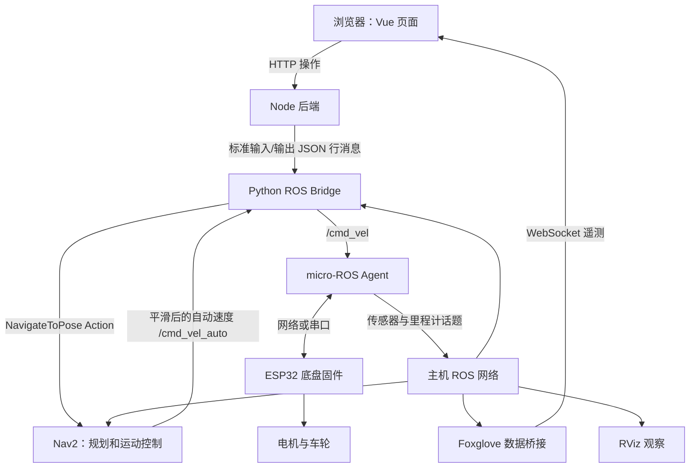

# LDC 仓库架构与代码阅读指南

更新：2026-11-07。适用根目录：`/home/<user>/ros-car-migration`。

本仓库包含小车上的固件、电脑上的 ROS 程序、网页控制台，以及启动和测试工具。先理解这些部分之间的关系，再阅读具体算法。

最新实现补充：[MCU统一运动安全修复](LDC-MCU统一运动安全修复.md)。底盘入口已统一经过 motion_authority，旧的急停/手柄共享标志及运动覆盖队列已移除；下文的旧队列链路以此补充为准。

## 查询目录

- [仓库目录总览](#仓库目录总览)
- [运行时架构与数据流](#运行时架构与数据流)
- [底盘与图传固件](#底盘与图传固件)
- [主机 ROS 功能包](#主机-ros-功能包)
- [网页前后端](#网页前后端)
- [脚本与仿真](#脚本与仿真)
- [三条业务链路](#三条业务链路)
- [从哪里开始读](#从哪里开始读)
- [按问题查代码](#按问题查代码)
- [当前实现与后续架构的区别](#当前实现与后续架构的区别)

## 仓库目录总览

```text
ros-car-migration/
├── firmware/                 ESP32-S3 上运行的程序
│   ├── chassis/              底盘：运动、编码器、雷达、IMU、通信
│   └── camera_stream/        图传：摄像头、Wi-Fi、MJPEG
├── agent_ws/                 主机 micro-ROS Agent 工作空间
├── robot_ws/                 主机 ROS 功能工作空间
│   ├── src/                  功能包源码，主要修改这里
│   ├── build/                构建中间产物
│   ├── install/              构建安装结果，ROS 运行时加载
│   └── log/                  构建日志
├── web_console/              Vue 前端与 Node 后端
│   ├── src/                  页面、组件、数据订阅
│   └── tests/                前后端回归测试
├── scripts/                  环境、启动、ROS 控制、诊断与仿真
├── maps/                     运行时地图
├── docs/                     项目说明
├── lichtblick/               独立 ROS 数据可视化工具源码
├── legacy/                   旧程序存档
├── migration/                历史迁移资料
└── migration-tools/          迁移、比对及部分历史验收工具
```

优先阅读 `firmware/chassis`、`robot_ws/src`、`web_console`、`scripts`。`lichtblick` 并非当前 Vue 网页的源码。

`build/`、`install/` 和依赖目录通常不直接修改：修改安装结果可能暂时生效，但再次构建会被覆盖。`firmware/*/managed_components/` 主要是 SDK 管理的依赖，应用代码优先看 `main/` 和自有 `components/`。

## 运行时架构与数据流

以下为网页控制、micro-ROS 模式的主要链路；MAVLink 是可选通信模式。



| 层 | 主要职责 | 不应混淆的边界 |
|---|---|---|
| Vue 页面 | 输入操作、地图交互、展示状态 | 页面接近目标不等于导航成功 |
| Node 后端 | HTTP 接口、配置、地图文件、子进程管理 | 后端存活不等于 ROS 就绪 |
| Python Bridge | ROS 通信、控制权、就绪检查、任务与速度门控 | 是控制台模式下的运动协调节点 |
| Nav2 | 规划路径、跟踪路径、计算速度 | 不直接控制电机 PWM |
| micro-ROS Agent | MCU 与 ROS 网络接入 | 不规划路径、不做轮速闭环 |
| MCU | 采样、运动学、控制周期、PID、电机输出 | 主机软件测试不能替代固件和硬件验收 |
| RViz | 显示话题、TF、地图与路径 | 当前观察配置不负责目标和急停操作 |

ROS 术语：**节点**是运行中的功能程序；**Topic** 是连续数据流；**Service** 是请求/响应；**Action** 用于可反馈、可取消的长任务；**TF** 描述坐标系关系。

## 底盘与图传固件

底盘使用 ESP-IDF、FreeRTOS，多任务通过队列和共享状态协作。

```text
firmware/chassis/
├── main/
│   ├── app_main.cpp          入口
│   ├── app_runtime.cpp       初始化配置、硬件、队列、任务
│   ├── config/               引脚、几何尺寸、运动和通信参数
│   ├── core/                 SystemGlobals：共享状态和队列
│   ├── msg/                  固件内部消息结构
│   ├── control/              运动控制器、差速运动学
│   └── tasks/
│       ├── control/          运动控制任务
│       ├── sensors/          雷达、IMU、电池、超声采样
│       ├── io/               手柄和外设
│       └── network/          micro-ROS、MAVLink、配网
├── components/               电机、编码器、PID等驱动
└── tests/                    宿主测试与硬件替身
```

| 关键文件 | 阅读目的 |
|---|---|
| [app_main.cpp](../firmware/chassis/main/app_main.cpp) | 确认程序入口，调用运行时初始化 |
| [app_runtime.cpp](../firmware/chassis/main/app_runtime.cpp) | 看上电初始化与通信模式选择、任务创建 |
| [system_globals.h](../firmware/chassis/main/core/system_globals.h) | 查队列、共享标志和运行配置 |
| [motion_msg.h](../firmware/chassis/main/msg/motion_msg.h) | 查运动命令和遥测字段 |
| [motion_task.cpp](../firmware/chassis/main/tasks/control/motion_task.cpp) | 看每个控制周期、命令选择、超时和停车 |
| [motion_controller.cpp](../firmware/chassis/main/control/motion_controller.cpp) | 看轮速反馈、里程积分、外环控制和 PWM 计算 |
| [differential_kinematics.cpp](../firmware/chassis/main/control/differential_kinematics.cpp) | 看车体线/角速度与左右轮速度之间的转换 |
| [motion_config.h](../firmware/chassis/main/config/motion_config.h) | 查轮径、轮距、编码器计数、PID和限幅 |
| [microros_subscribers.cpp](../firmware/chassis/main/tasks/network/microros/microros_subscribers.cpp) | 看 ROS 命令如何转成固件内部消息 |
| [microros_publishers.cpp](../firmware/chassis/main/tasks/network/microros/microros_publishers.cpp) | 看固件数据如何组织成 ROS 消息 |
| [encoder_driver.cpp](../firmware/chassis/components/encoder_driver/encoder_driver.cpp) | 看 PCNT 编码器驱动 |
| [pid_controller.cpp](../firmware/chassis/components/pid_controller/pid_controller.cpp) | 看 PID 通用实现 |

`main/msg/` 是固件内部数据结构，不能直接当作 ROS 消息定义。

图传固件入口是 [camera_stream/main/main.c](../firmware/camera_stream/main/main.c)，相机初始化看 `camera_init.c`，流服务看 `web_mjpeg.c`，联网看 `wifi_manager.c`。它是独立固件，不在底盘控制周期里执行图像识别。

## 主机 ROS 功能包

源码位置：[robot_ws/src](../robot_ws/src)。

| 包 | 职责 |
|---|---|
| `ldc_bringup` | 基础启动组合；当前订阅 `/odom` 并广播 odom→base_footprint |
| `ldc_description` | URDF 车体模型、传感器安装外参与固定坐标关系 |
| `slam_gmapping` | GMapping 的 ROS 节点和话题/TF 接入 |
| `openslam_gmapping` | GMapping 底层算法库 |
| `ldc_navigation` | Nav2 启动、参数、自定义规划器与平滑器 |
| `ldc_cartographer` | Cartographer 配置和启动入口 |
| `camsense_lidar` | 主机雷达驱动，是否使用取决于实际接线和数据来源 |
| `ldc_mavlink_bridge` | MAVLink 模式的主机通信桥 |
| `ldc_camera` | 摄像头发现和 HTTP 视频接入 ROS |
| `ldc_qt_gui`、`ldc_servo_gui` | 独立 Qt 界面 |
| `leap_interfaces` | 自定义 ROS 接口，例如速度 PID 服务 |

常见包内结构：

```text
package.xml       包名、依赖及导出声明
CMakeLists.txt    C++代码和资源的构建安装规则
setup.py          Python包的安装规则（部分包使用）
src/              C++实现
include/          C++头文件
launch/           启动哪些节点、如何传参和重映射
param/、config/   节点与算法参数
```

**launch 文件负责组装运行系统，算法实现可能在其他包或系统安装目录中。**

当前默认导航入口是 [navigation2.launch.py](../robot_ws/src/ldc_navigation/launch/navigation2.launch.py)，默认参数是 [ldc_nav2.yaml](../robot_ws/src/ldc_navigation/param/ldc_nav2.yaml)。该配置使用 AMCL、NavFn（`use_astar: false`）和 DWB。标准 Nav2 算法主体来自已安装的 Nav2 软件包，并非全部保存在本仓库。

自定义规划算法位于 `ldc_navigation/include/`、`src/`，独立配置包括 `nav2_planning_arena.yaml`。有文件不代表默认导航已加载它，必须沿 launch→参数→plugin 核对。

当前主要 TF 关系：

```text
map → odom → base_footprint → base_link → 各传感器坐标系
```

- map→odom：建图时由 SLAM，已知地图导航时由 AMCL 提供。
- odom→base_footprint：当前由 `ldc_bringup` 根据 `/odom` 提供。
- 固定车体与传感器关系：由 URDF 和 robot_state_publisher 提供。

## 网页前后端

| 文件 | 职责 |
|---|---|
| [src/main.js](../web_console/src/main.js) | Vue 应用入口 |
| [src/App.vue](../web_console/src/App.vue) | 页面总协调、遥控状态、控制权、目标预览和组件连接 |
| [SlamMap.vue](../web_console/src/components/SlamMap.vue) | 地图/雷达/相关图层绘制，以及目标和位姿交互 |
| [NavigationControl.vue](../web_console/src/components/NavigationControl.vue) | 导航面板与状态展示 |
| [MappingControl.vue](../web_console/src/components/MappingControl.vue) | 建图操作和保存状态 |
| [useFoxglove.js](../web_console/src/composables/useFoxglove.js) | WebSocket 遥测连接、订阅和消息处理 |
| [mapCoordinates.js](../web_console/src/lib/mapCoordinates.js) | 地图与屏幕坐标转换 |
| [tfTransforms.js](../web_console/src/lib/tfTransforms.js) | TF 缓存和坐标变换 |
| [server.js](../web_console/server.js) | Node 后端入口、任务启动和通用接口 |
| [navigationRoutes.js](../web_console/navigationRoutes.js) | 导航/控制 HTTP 接口和进程协调 |
| [navigationBridge.js](../web_console/navigationBridge.js) | Python 子进程及 JSON 行请求/响应 |
| [mapStorage.js](../web_console/mapStorage.js) | 地图保存、文件完整性和发布 |
| [managedProcess.js](../web_console/managedProcess.js) | 子进程树清理 |
| [ros_config.json](../web_console/ros_config.json) | 启动任务、路径和桥接配置 |

JavaScript 后端负责 Web 和进程管理，Python Bridge 使用 `rclpy` 负责 ROS。两者通过标准输入/输出交换 JSON 行消息，不是两套独立导航算法。

## 脚本与仿真

| 入口 | 职责 |
|---|---|
| [env.bash](../scripts/env.bash) | 加载 ROS、Agent 和主机工作空间环境 |
| [navigation_bridge.py](../scripts/navigation_bridge.py) | ROS 控制节点，管理 Action、控制权、状态、传感器检查和速度门控 |
| [mapping_preflight.py](../scripts/mapping_preflight.py) | 建图前检查 |
| [offline_robot.py](../scripts/offline_robot.py) | 模拟底盘运动、雷达、里程计和 TF |
| [offline_console.py](../scripts/offline_console.py) | 组织隔离仿真服务 |
| [offline_acceptance.py](../scripts/offline_acceptance.py) | 自动验收流程 |
| [start_rviz.sh](../scripts/start_rviz.sh) | 实车/仿真 RViz 观察入口 |
| [ros_doctor.sh](../scripts/ros_doctor.sh) | 链路诊断 |
| [build_host.sh](../scripts/build_host.sh)、[build_agent.sh](../scripts/build_agent.sh) | 主机与 Agent 构建 |
| [test_chassis_core.sh](../scripts/test_chassis_core.sh) | 控制器和平滑器宿主回归 |

`scripts/` 不只是 shell 工具目录：`navigation_bridge.py` 是实际控制链路的一部分。

RViz 配置在 [scripts/rviz](../scripts/rviz)：基础诊断以 `odom` 为 Fixed Frame，建图/导航观察以 `map` 为 Fixed Frame。初始位置、目标、取消和急停统一在网页操作。

## 三条业务链路

### 遥控：一次点击如何让车轮转动

```text
App.vue / JoystickControl.vue
→ HTTP 速度接口（控制权、controlId、sequence）
→ navigationRoutes.js → navigationBridge.js
→ navigation_bridge.py 检查状态并发布 /cmd_vel
→ micro-ROS Agent → MCU 的 handle_cmd_vel
→ motion_authority 授权检查与最新命令邮箱 → motion_task
→ MotionController → 差速运动学 → 轮速 PID → 电机 PWM
```

### 遥测：雷达如何显示到网页

```text
MCU 雷达驱动与 lidar_task
→ micro-ROS 发布 /scan → Agent → ROS 网络
→ Foxglove Bridge → useFoxglove.js
→ 页面更新 scan 数据 → SlamMap.vue 绘制
```

这是 MCU 雷达发布模式的链路。主机串口雷达驱动模式会从主机驱动开始；同一台物理雷达不要同时启用两份有效 `/scan` 数据源。

### 导航：地图目标如何执行

```text
SlamMap.vue 选择目标 → App.vue 预览和确认
→ Node 导航接口 → Python Bridge 的 NavigateToPose 客户端
→ Nav2 行为树、规划器、控制器
→ /cmd_vel_nav → velocity_smoother → /cmd_vel_auto
→ Python Bridge 运动门控 → /cmd_vel → MCU → 电机
```

结果反向返回页面。多点任务由 Bridge 顺序提交单点 Action，收到成功结果才推进下一点；剩余距离很小不等于 Action 成功。

以上自动速度重映射适用于控制台管理模式；直接运行导航 launch 的默认输出参数不同。

## 从哪里开始读

第一遍按以下顺序，每次只追一个问题：

1. [start_console.sh](../web_console/start_console.sh)：网页入口到底启动了什么？注意它不启动 Agent 和底盘 bringup。
2. [App.vue](../web_console/src/App.vue)：按钮事件如何变成请求？
3. [navigationRoutes.js](../web_console/navigationRoutes.js) → [navigationBridge.js](../web_console/navigationBridge.js)：HTTP 如何进入 ROS 控制进程？
4. [navigation_bridge.py](../scripts/navigation_bridge.py)：谁管理控制权、传感器新鲜度、目标受理和取消？优先看 `process`、`tick`、`next_goal`、`accepted`、`completed`。
5. [navigation2.launch.py](../robot_ws/src/ldc_navigation/launch/navigation2.launch.py) → [ldc_nav2.yaml](../robot_ws/src/ldc_navigation/param/ldc_nav2.yaml)：导航节点及实际插件如何选择？
6. [app_main.cpp](../firmware/chassis/main/app_main.cpp) → [app_runtime.cpp](../firmware/chassis/main/app_runtime.cpp)：车端启动哪些任务？
7. [motion_task.cpp](../firmware/chassis/main/tasks/control/motion_task.cpp) → [motion_controller.cpp](../firmware/chassis/main/control/motion_controller.cpp)：控制周期如何计算并输出？

第一遍暂不钻进 SDK、Nav2 和 GMapping 底层源码，先串通命令下发和遥测上行两条链。

## 按问题查代码

| 想理解或修改的行为 | 先看哪里 |
|---|---|
| 按钮、档位、按住行驶、失焦停车 | `App.vue`、`JoystickControl.vue` |
| 车已断开，页面仍显示在线 | `App.vue` 数据新鲜度、`useFoxglove.js`、`ConnectionPanel.vue` |
| 地图点击与目标坐标不一致 | `SlamMap.vue`、`mapCoordinates.js`、`tfTransforms.js` |
| 地图保存失败或加载了旧地图 | `server.js`、`mapStorage.js`、`navigationRoutes.js` |
| 导航未就绪、目标拒绝、取消无效 | `navigation_bridge.py`、导航路由、对应事件和 ROS 日志 |
| 无路、轨迹无效、转向卡住 | 实际 Nav2 参数、定位和 costmap；先查运行数据再调参 |
| 电机方向、轮速、PID、里程尺度 | 固件 `motion_config.h`、运动控制器及驱动 |
| TF 缺失或重复 | `ldc_bringup`、`ldc_description`、SLAM/AMCL 启动组合 |
| 无实车复现软件流程 | `offline_console.py`、`offline_robot.py`、验收程序 |

## 当前实现与后续架构的区别

- 当前标准 bringup 未启用 EKF。存在 `config/ekf.yaml` 不代表运行中已经融合定位；未来启用 EKF 时要交接 odom→base 的唯一发布职责。
- 当前实车导航尚未稳定验收；离线验收不代表实车定位、制动和避障通过。
- 2026-11-07 MCU 优化已通过宿主回归，完整 IDF 构建受环境缺失阻塞，尚未刷入实车。源码内容不一定等于车上烧录版本。
- 安全状态机、同步状态、抗饱和、真实传感器时间映射、完整路径扫掠碰撞等仍有后续工作。

操作命令、RViz 使用和后续计划见 [LDC使用与演进计划](LDC使用与演进计划.md)；离线流程详见 [OFFLINE_NAVIGATION.md](../web_console/OFFLINE_NAVIGATION.md)。
