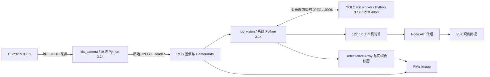

# LDC 摄像头、YOLO、网页与 RViz

本批实现的是观察链路：摄像头 MJPEG → ROS 图像 → YOLO26n → 标准二维检测 → 网页 / RViz。视觉包没有速度或导航目标发布者，未接入自动驾驶决策。固件与导航、MCU 安全策略没有修改。

## 快速使用

先在项目目录准备已有模型并构建（不重新训练、不转 TensorRT）：

```bash
cd /home/<user>/ros-car-migration
bash scripts/prepare_vision.sh
bash scripts/build_host.sh --packages-select ldc_camera ldc_vision ldc_description
```

日常启动原中控台：

```bash
bash /home/<user>/ros-car-migration/web_console/start_console.sh
```

打开 `http://localhost:5173/`，找到“摄像头与 YOLO”：

1. 填入实际 MJPEG 地址，或“自动发现”。地址留空也可在启动时发现。
2. 保持 GPU 0，点击“启动视觉”。摄像头连接状态与识别状态分别显示；模型首次加载需要等待。
3. 选择“原图”或“YOLO 识别图”；类别可选全部通用类别，或交通灯 / STOP。
4. “当前帧未检测到所选类别”代表有效空结果；“识别服务未就绪”代表结果无效，两者分开处理。
5. 推理报错时仍可切换原图。修复原因后点击“停止视觉”，再“启动视觉”；不会静默改用 CPU。
6. 页面刷新会查询后端状态并恢复观察，不重新连接 ESP32。切换标签不产生第二路摄像头采集。

**注意：已运行的 Node 后端需要重启，才能加载新增 `/api/vision/*` 接口。** 本批不自动重启用户正在使用的实车控制台。若接口返回 404，请先停止当前控制台，再用上面的入口启动。修改 Vue 后 Vite 会热更新，后端代码不会自动热更新。

也可以独立启动视觉，不启动建图或导航：

```bash
bash /home/<user>/ros-car-migration/scripts/start_vision.sh --real
# 或手动 URL，避免依赖发现
bash /home/<user>/ros-car-migration/scripts/start_vision.sh --real 'url:=http://<CAMERA_IP>:81/'
# 显式 CPU；性能目标只针对默认 GPU 配置
bash /home/<user>/ros-car-migration/scripts/start_vision.sh --real 'url:=http://<CAMERA_IP>:81/' device:=cpu
```

命令行 `Ctrl+C` 退出整组。网页“停止视觉”也能停止命令行启动的视觉会话。重复启动同一模式会返回现有状态，不新建采集连接；实际修改参数需要先停止。后端退出只清理由该后端创建的视觉进程，单纯查询终端会话不会取得其生命周期所有权。

## 传感器与标定边界

实机传感器型号目前**待确认**，不根据固件目录名推断 OV2640 或 OV3660。MJPEG 接入按每张 JPEG 的实际尺寸工作，不依赖具体型号。已有固件能检测传感器，但当前 HTTP 接口未提供型号查询，因此本批未声称自动识别型号。

时间戳是**主机收到完整 JPEG 的时间，不是曝光时间**。采集只保留最新完整帧，默认发布上限 10 FPS，Best Effort、Keep Last、depth=1。原始 JPEG 不重新编码；raw RGB 仅在启用且有订阅者时产生。Socket 读取超时 2 秒，断开后间隔 2 秒重连；图像 / 结果年龄超过 1 秒不再显示。

未提供真实标定文件时，`CameraInfo.K[0] == 0`，诊断报告未标定，不估计焦距或距离。标定文件必须是 ROS 常见的 YAML 格式，包含 `image_width`、`image_height`、`camera_matrix`、`rectification_matrix`、`projection_matrix`、`distortion_coefficients`、`distortion_model`。尺寸失配时仍发布当前尺寸的未标定 CameraInfo，不能拿旧分辨率参数冒充有效标定。

```bash
bash /home/<user>/ros-car-migration/scripts/start_vision.sh --real \
  'url:=http://<CAMERA_IP>:81/' 'calibration_file:=/ABS/PATH/camera.yaml'
```

URDF 保留 `camera_link` 原安装位置，仅增加标准 `camera_optical_frame` 固定旋转 `rpy="-pi/2 0 -pi/2"`：光学轴 x 向右、y 向下、z 向前。安装外参未实测，不用于视觉测距或空间融合。

## 数据与代码位置



| 路径（相对 `/home/<user>/ros-car-migration`） | 职责 |
| --- | --- |
| `robot_ws/src/ldc_camera/ldc_camera/mjpeg.py` | 有界 multipart 分片解析、截断 / 超大帧拒绝 |
| `robot_ws/src/ldc_camera/ldc_camera/http_video_publisher.py` | 单路读取、最新帧、时间戳、按需 raw、重连、诊断 |
| `robot_ws/src/ldc_camera/ldc_camera/calibration.py` | 真实标定加载及 CameraInfo 失配处理 |
| `robot_ws/src/ldc_vision/ldc_vision/node.py` | 一帧推理中 + 一帧最新待处理、标准 ROS 消息、过滤及状态 |
| `robot_ws/src/ldc_vision/ldc_vision/worker.py` | Python 3.12 内加载本地 YOLO26n 和 PyTorch |
| `robot_ws/src/ldc_vision/ldc_vision/ipc.py` | uint32LE JSON 长度 + JSON + uint32LE JPEG 长度 + JPEG |
| `robot_ws/src/ldc_vision/ldc_vision/worker_client.py` | worker 生命周期、加载 / 推理超时、终止与回收 |
| `robot_ws/src/ldc_vision/ldc_vision/results.py` | 帧身份、Header、尺寸、有限数值与原图框校验 |
| `robot_ws/src/ldc_vision/ldc_vision/gateway.py` | 本地原图 / 叠框流、状态、过滤、受限并发 |
| `robot_ws/src/ldc_vision/config/vision.yaml` | 默认推理参数 |
| `robot_ws/src/ldc_vision/launch/vision.launch.py` | 两节点启动、任一节点退出后清理整组 |
| `web_console/visionRoutes.js` | 幂等启动、停止、只代理固定 loopback 网关、慢客户端隔离 |
| `web_console/src/components/CameraView.vue` | 网页视觉控制、有效空结果与故障区分 |
| `web_console/managedProcess.js` | 遍历所有线程创建的子进程，避免遗漏 YOLO worker |
| `scripts/start_vision.sh` | 实车 / 隔离仿真启动、单例锁 |
| `scripts/vision/` | 模拟源、离线入口、真实样例推理、集成与长稳测试 |

| 话题 | 类型 | 说明 |
| --- | --- | --- |
| `/camera/image_raw/compressed` | `sensor_msgs/msg/CompressedImage` | 摄像头原始 JPEG |
| `/camera/image_raw` | `sensor_msgs/msg/Image` | RGB8，按订阅需求发布 |
| `/camera/camera_info` | `sensor_msgs/msg/CameraInfo` | 与来源图像相同 Header、尺寸 |
| `/vision/detections` | `vision_msgs/msg/Detection2DArray` | 类别名、置信度、原图像素框 |
| `/vision/annotated/compressed` | `sensor_msgs/msg/CompressedImage` | 同一次推理输入对应的叠框图 |
| `/vision/annotated` | `sensor_msgs/msg/Image` | RGB8，按订阅需求发布 |
| `/diagnostics` | `diagnostic_msgs/msg/DiagnosticArray` | 采集、标定、推理、FPS、p95、丢帧与故障 |

检测使用原始输入 Header。框中心和宽高都是**原图像素**，不是页面坐标或地图坐标；Ultralytics 已把 letterbox 结果还原到原图，不能二次缩放。没有启用跟踪，`Detection2D.id` 留空。`ObjectHypothesisWithPose` 是标准消息容器，其默认 pose **不代表有效三维估计**，本批不消费或展示该 pose。消息约定参照 [vision_msgs Detection2D](https://github.com/ros-perception/vision_msgs/blob/ros2/vision_msgs/msg/Detection2D.msg)。

没有新目标时发布有效空数组；输入过期、worker 超时或退出时网关立即按有效性屏蔽旧结果，并由 ROS 定时器发布一次空数组清除旧检测。视觉故障不会停止原始图像采集，也不会自动恢复为车辆行动。

## 参数与本机依赖

| 参数 | 默认值 | 可用方式 |
| --- | --- | --- |
| `device` | `'0'` | `device:=cpu` 显式切换 |
| `imgsz` | `640` | launch 参数，32–1280 |
| `confidence` | `0.25` | launch 参数，(0,1] |
| `class_filter` | `all` | `all` / `traffic`，网页可修改 |
| `worker_python` | `/home/<user>/esp/yolo-bench-env/bin/python` | 已有 Python 3.12 环境 |
| `model_path` | `/home/<user>/.local/share/ldc/models/yolo26n.pt` | 本地文件，禁止自动下载 |
| `calibration_file` | 空 | 实际标定 YAML |
| `read_timeout` | `2.0` 秒 | 摄像头 socket 读取超时 |
| `gateway_port` | 实车 18320 / 仿真 18321 | 由统一脚本固定，避免模式混用 |

推理超时 5 秒，初始化超时 45 秒；输入和结果超过 1 秒丢弃。没有无限帧队列，统计窗口和客户端数也有界（网关最多 4 路流、8 个并发请求；Node 最多 4 路流）。慢客户端有超时和有界背压，采集和推理不等待客户端。

本机模型 SHA256：`9b09cc8bf347f0fc8a5f7657480587f25db09b34bf33b0652110fb03a8ad4fef`。模型从已有审计目录复制，未下载新权重。`prepare_vision.sh` 遇到不同的已存在模型会报错，不覆盖。

本批安装标准 `ros-lyrical-vision-msgs`，版本 `4.2.0-3resolute.20260915.050641`。PyTorch 只在现有 Python 3.12 环境内；ROS Python 3.14 未安装 PyTorch。本机完整版本清单保存在审计目录的 `worker-dependencies.json` / `ros-dependencies.json`，环境调整后应重新执行真实推理测试。

Lyrical 的 `DiagnosticStatus.level` 在当前安装中是 byte，使用 `DiagnosticStatus.OK/WARN/ERROR`，不能直接传整数。此问题已加序列化回归，避免运行时 C 扩展断言退出。

## API 与状态排查

Node 端口沿用现有控制台，默认 `3000`，可通过 `ROBOT_API_PORT` 设置；前端使用对应的 `VITE_ROBOT_API_PORT`。

| 方法与路径 | 用途 |
| --- | --- |
| `POST /api/vision/start` | `{ "url": "http://<CAMERA_IP>:81/", "device": "0", "filter": "all" }`；空 URL 可发现 |
| `POST /api/vision/stop` | 停止并清理完整视觉进程树 |
| `GET /api/vision/status` | camera / detector 各自健康、帧信息、检测列表、FPS、p95、丢帧 |
| `POST /api/vision/filter` | `{ "filter": "traffic" }` 或 `all` |
| `GET /api/vision/raw.mjpg` | 本机原图流 |
| `GET /api/vision/annotated.mjpg` | 同帧叠框图流 |

网关只绑定 `127.0.0.1`；浏览器通过 Node 访问，不直连 ESP32，也不直接连网关。视觉启动不要求底盘控制权和 ROS 导航就绪。

```bash
curl -fsS http://127.0.0.1:3000/api/vision/status
source /home/<user>/ros-car-migration/scripts/env.bash
ros2 topic echo /diagnostics
ros2 topic echo /vision/detections --qos-reliability best_effort --once
```

- 摄像头失败：检查设备供电、同一网络、URL 是否为 MJPEG 流、是否已有另一工具直连设备；不要把静态图片 URL 当 MJPEG。
- 摄像头正常但识别失败：查 `detector.detail`、模型路径、worker Python 和 GPU；需要 CPU 时显式选择。
- 显示未标定：图像和二维识别仍可用；不要用二维框估计距离。
- 识别列表为空但 detector 正常：代表当前选择下没检出，不等于模型失效。
- 摄像头已经断开却仍看到最后一帧：应在图像年龄超过 1 秒、下一轮状态刷新后卸载画面；若页面仍不更新，先确认 Node 已重启且页面是新版本。

## RViz 观察

```bash
bash /home/<user>/ros-car-migration/scripts/start_rviz.sh --real --vision
# 离线测试时
bash /home/<user>/ros-car-migration/scripts/start_rviz.sh --sim --vision
```

配置只使用内置 `rviz_default_plugins/Image`，两个图像显示分别订阅 `/camera/image_raw` 与 `/vision/annotated`，Best Effort、depth=1。不要求检测框可视化插件，框已经画入同帧图像。`Image` 显示的 Status 可查看话题健康；结构化 `/diagnostics` 请在旁边终端执行上述 `ros2 topic echo /diagnostics`，RViz 默认插件没有 DiagnosticArray 面板，本批未把它冒充为 RViz 原生能力。

若没看到图像，展开显示项的 `Topic`，确认话题、QoS 和 Enabled。统一视觉启动默认启用按需 raw；仅启动旧摄像头节点时需要 `publish_raw:=true`。单独离线视觉没有启动 robot_state_publisher，Fixed Frame 可能提示 TF 不存在；这不妨碍二维 Image 窗口接收图像，不表示已标定外参。实车更新 URDF 需要下次正常启动描述节点，不在车辆运动中替换 TF。

## 离线演示与测试

离线入口独立于建图 / 导航仿真，固定 Domain 197、localhost 发现、18321 网关；模拟源默认 18322。不会发现实车，不使用实车地图目录。

```bash
source /home/<user>/ros-car-migration/scripts/env.bash
python3 /home/<user>/ros-car-migration/scripts/vision/offline.py \
  --image /home/<user>/ros-car-migration-audit/yolo-integration/bus.jpg
```

打开 `http://localhost:5175/`；视觉卡标注“仿真”。此入口只启动模拟摄像头、视觉栈、Node 与 Vite；底盘 / 激光 / 建图 / 导航保持离线。`Ctrl+C` 清理整组；端口已被占用则报错，不接管别人的会话。

```bash
cd /home/<user>/ros-car-migration
bash scripts/test_vision.sh --unit
# 集成故障注入使用 Domain 196、18323 网关、18324 模拟源，避免打断长稳测试
bash scripts/test_vision.sh --integration /home/<user>/ros-car-migration-audit/yolo-integration/bus.jpg
# 独立启动并真实运行 1800 秒，不用短测替代
bash scripts/test_vision.sh --soak /home/<user>/ros-car-migration-audit/yolo-integration/bus.jpg
# 真实样例推理与原图/JSON/叠框图输出
python3 scripts/vision/run_samples.py --images /ABS/PATH/*.jpg --output /ABS/PATH/results
```

`run_samples.py` 是代表类别验收入口，输入集合应包含通用物体、交通灯、STOP；未全部实际检出会返回失败，完整 JSON 和图片仍保留用于分析。不要以此作为完整精度评测。本轮使用 COCO128 中少量代表图片作软件验证，未下载完整训练集，未训练模型。

测试结果见 [本批测试报告](LDC视觉接入测试报告.md)。实际相机画面、安装朝向、实机网络延迟、传感器型号、标定与误检效果仍需实机验收；通用模型含交通灯和英文 STOP 类，不默认支持其他交通标志或中文“停”字，**交通灯始终标注“灯色未判定”**。

## 备份与逐文件回滚

本批审计目录：`/home/<user>/ros-car-migration-audit/vision-20261108/`。`before/` 保存修改前的逐文件内容，`before-sha256.json` 为其校验。`changes.json` 记录本批交付文件与交付后的 SHA256；`rollback.py` 可以预览并只回滚指定文件。不要用 `git reset --hard`，仓库原来有用户未提交修改。

```bash
# 先停止本批启动的视觉功能；预览，不改文件
python3 /home/<user>/ros-car-migration-audit/vision-20261108/rollback.py
# 示例：回滚单一已有文件（自动保全回滚前内容）
python3 /home/<user>/ros-car-migration-audit/vision-20261108/rollback.py \
  --file web_console/src/components/CameraView.vue --apply
```

新增文件的回滚采用移动到审计目录的隔离区，不直接删除。若交付后文件又有变化，脚本拒绝覆盖，先人工对比。ROS / launch / URDF 回滚后重新构建对应包；网页改动回滚后重新构建前端并重启 Node。模型和已安装标准消息包不会随源码回滚而删除。
